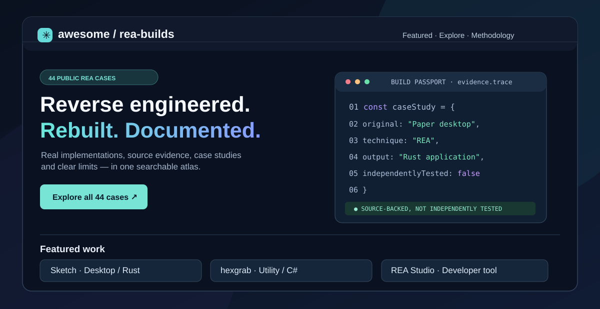

<div align="center">

# ✳ Awesome REA Builds

**Reverse engineered. Rebuilt. Documented.**

An independent, evidence-linked atlas of **real REA (Reverse Engineer Anything) implementations, official showcases, research cases and integrations**.

[Explore 44 cases](#full-catalog--44-cases) · [Build Passports](#build-passports) · [Verification policy](METHODOLOGY.md) · [Contribute](CONTRIBUTING.md) · [GitHub Pages setup](docs/GITHUB_PAGES.md)



</div>

> [!IMPORTANT]
> **Scope and trust:** 44 public cases, **not 44 independently verified working apps**. We catalog 14 app reconstructions, 6 interoperability projects, 6 integrations, 5 official focused studies, 10 analysis cases and 3 learning resources. Official showcases, GitHub Discussions and studies are labeled as such. We have not independently built or executed third-party code.

## What makes this different?

Other valuable REA directories cover a huge range of links. Here each case receives a **Build Passport** (implementation) or **Case Passport** (analysis/showcase), with exactly what REA contributed, direct upstream evidence, what exists, execution status and limitations. The interactive website supports search, multi-filter discovery, deep links and side-by-side comparison.

The public sources for 42 of the 44 catalogued cases were retrievable through our GitHub research connection on **November 11, 2026**. Two community GitHub Discussion links could not be retrieved through the available interfaces and are explicitly marked **discussion listed**, not verified. A retrievable source does *not* mean we confirmed that its application works.

## Website

This project is ready for **GitHub Pages**. For this public repository, set **Settings → Pages → Build and deployment → Source: GitHub Actions**. The included workflow will build and publish the self-contained static site on push to `main`.

- Run locally: `python3 scripts/build.py && python3 -m http.server 8080 --directory dist`
- Visit: `http://localhost:8080`
- No Node install, server, API keys, backend or external deployment service is required. The site works offline, with system-font fallbacks.
- The expected future GitHub Pages address will be `https://notsointresting.github.io/awesome-rea-builds/` **after it is actually published**.

## Build Passports

Each record includes its target, implementation or study, primary evidence link, technology when known, platform when confirmed, source-reported outputs, limitations, review date and independent-execution state. **Unknown** remains unknown; we never fill gaps with guessed compatibility, build commands or benchmark claims.

## Full catalog — 44 cases

### Desktop apps (6)

| Case / project | Type | What it investigates or builds |
| --- | --- | --- |
| [Sketch](https://github.com/michaelshimeles/sketch) | Reconstructed application | An independent Rust design canvas with pages, vector tools, planning boards and a desktop-native graphics stack. |
| [rec-rs](https://github.com/michaelshimeles/rec-rs) | Reconstructed application | Rust-based screen and camera recording for macOS, with sources, scenes, settings and a focused native workflow. |
| [Open Claude UI](https://github.com/Caho1/open-claude-ui) | Reconstructed application | A library of UI components, visual behavior and interaction details informed by a technical study of a desktop application. |
| [Ledger Reborn](https://github.com/lxistired/ledger-reborn) | Reconstructed application | An independent local accounting application influenced by research into familiar desktop bookkeeping workflows. |
| [Terminal — TradingView-inspired charts](https://github.com/michaelshimeles/terminal) | Reconstructed application | A separate market-terminal implementation informed by passive REA capture and public-chart interaction analysis. |
| [DiskLens](https://github.com/KarlssonChristoffer/DiskLens) | Reconstructed application | Disk-analysis and treemap implementation informed by REA review of WinDirStat enumeration and display behavior. |

### Games & preservation (6)

| Case / project | Type | What it investigates or builds |
| --- | --- | --- |
| [Desktop Games Nostalgia](https://github.com/ucodia/desktop-games-nostalgia) | Reconstructed application | Recreates a playful Windows desktop toy for macOS and the browser, with documented sprite and runtime recovery. |
| [Ski or Die: Snowball War](https://github.com/tuunanet/rea-ski-or-die-reconstruction) | Reconstructed application | Playable Rust + SDL2 reconstruction with behavior specifications for throwing, collision and scoring. |
| [OpenBattlefield2](https://github.com/Moxnatiy/OpenBattlefield2) | Reconstructed application | Documented REA/Ghidra function-level analysis supporting an open implementation of portions of the Battlefield 2 engine. |
| [GunZRs](https://github.com/OpenRsG/GunZRs) | Reconstructed application | Uses REA and Ghidra to inspect archive formats, native binaries and packing boundaries for a Rust-based recreation. |
| [Co-op Anything](https://github.com/cranebeaker/coop-anything) | Research & analysis | Research notes locate campaign/multiplayer entry points using REA and Ghidra; not a finished universal co-op patch. |
| [Open Scrantic](https://github.com/glauberlima/open-scrantic) | Reconstructed application | Rust replacement of a 1990s screensaver; author credits REA for understanding resource formats and script behavior. |

### Developer tools (2)

| Case / project | Type | What it investigates or builds |
| --- | --- | --- |
| [hexgrab](https://github.com/iammukeshm/hexgrab) | Reconstructed application | Minimal Windows color picker with a keyboard shortcut, pixel sampling and documented feature-level analysis. |
| [AdamTerm](https://github.com/AdamLinCodes/AdamTerm) | Reconstructed application | A macOS terminal implementation informed by a reverse-engineering investigation of another terminal. |

### Web & 3D (1)

| Case / project | Type | What it investigates or builds |
| --- | --- | --- |
| [Hyper3D Clone](https://github.com/payswapdotorg/hyper3d-clone) | Reconstructed application | Educational Next.js interface inspired by a browser-based 3D creation service. |

### Hardware & protocols (6)

| Case / project | Type | What it investigates or builds |
| --- | --- | --- |
| [PicoPrint](https://github.com/bigtower17/picoprint) | Interoperability implementation | Allows a small Bluetooth thermal printer to appear as a regular Windows printer through open-source tooling. |
| [VD Streamer Linux](https://github.com/cudanexus/vd-streamer-linux) | Interoperability implementation | An unofficial effort to make desktop video, audio and microphone streaming work from Linux to supported VR headsets. |
| [VSL-DSP](https://github.com/grisuno/VSL-DSP) | Interoperability implementation | Linux audio driver/DSP work informed by REA/Ghidra investigations of vendor library protocols and parameters. |
| [Pixel Watch eSIM handoff helper](https://github.com/AllMySlop/pixel-watch-esim-writer) | Interoperability implementation | A helper for QR/manual eSIM handoff informed by REA-assisted analysis of the companion app's configuration routes. |
| [V5VPN unofficial client research](https://github.com/hygkui/v5vpn-rea-client) | Interoperability implementation | Unofficial protocol client informed by static reversing references; exact REA contribution needs careful attribution. |
| [iCSee localmod](https://github.com/Vittuu/icsee-localmod) | Interoperability implementation | Researches local camera PTZ and lighting controls from stock firmware while preserving vendor drivers. |

### Official showcases (5)

| Case / project | Type | What it investigates or builds |
| --- | --- | --- |
| [DX-Ball sound-panning reconstruction](https://rea.tools/showcase/dx-ball/) | Official case study | Official investigation of x87 sound-panning arithmetic, cross-checking assembly, callers and differential tests. |
| [Notion clipboard bridge](https://rea.tools/showcase/notion/) | Official case study | Official investigation traces web editor, Electron preload, IPC and main-process clipboard calls; package versions are not fully matched. |
| [Touhou TH04 bullet-ring angles](https://rea.tools/showcase/th04/) | Official case study | Official REA and Ghidra examination of fixed-point bullet-angle computations and historical compiler comparisons. |
| [Aegis authenticator TOTP study](https://rea.tools/showcase/aegis/) | Official case study | Official Android investigation locates code-generation methods and checks an independent TOTP implementation against reference vectors. |
| [DownUnderCTF masked-squares solver](https://rea.tools/showcase/ctf/) | Official case study | Official static analysis recovers validation equations; Z3 solves constraints and original challenge process checks the candidate. |

### Analysis & evaluations (9)

| Case / project | Type | What it investigates or builds |
| --- | --- | --- |
| [Wispr Flow speech-input teardown](https://github.com/az9713/wispr-flow-rea-teardown) | Research & analysis | Uses REA and Ghidra to inspect speech-input and paste mechanics; includes a bounded local prototype rather than a complete replacement. |
| [Screen Studio static research](https://github.com/Royo-Qiao/screenstudio-rea-research) | Research & analysis | Bounded REA Mach-O and JavaScript inspection; documents timeouts and uncertainty rather than a full recorder rebuild. |
| [OpenBSD netcat binary analysis](https://github.com/NullLabTests/OpenBSD_netcat_REA) | Research & analysis | Compares static REA/Ghidra findings with readelf, objdump and other binary-inspection tools. |
| [REA analyzing REA](https://github.com/az9713/REA-demo) | Research & analysis | A controlled experiment asks REA to inspect its own package, form predictions and check those against source. |
| [REA Groundtruth](https://github.com/UnknownHacker1/rea-groundtruth) | Research & analysis | Tests REA output against known-source Electron and app examples to expose analysis blind spots. |
| [REA Lab](https://github.com/pablodiazjorge/rea-lab) | Research & analysis | Publishes controlled experiments, environments, function evidence and a repeatable research approach. |
| [bzip2 stripped-binary case](https://github.com/morluto/rea/discussions/2254) | Research & analysis | Community REA/Ghidra experiment recovers function references and checks them against a symbolized build. |
| [Local 27B REA function analysis](https://github.com/morluto/rea/discussions/3098) | Research & analysis | Community experiment uses a reduced set of REA MCP tools with a local model to analyze a small C program. |
| [Open-source REA package audit](https://github.com/martinlofranodeoliveira/opensource-rea-lab) | Research & analysis | Audits npm artifact hashes and analyzes two unchanged package entry files using REA. |

### Learning & experiments (3)

| Case / project | Type | What it investigates or builds |
| --- | --- | --- |
| [REA Playbook](https://github.com/jinshi666888/rea-playbook) | Learning material | Guided Electron analyze–extract–verify pipeline with pinned REA version and real tool-call probes. |
| [ReaFuse](https://github.com/sickpyramid/ReaFuse) | Learning material | Investigates utility-library semantics using REA before implementing independent combinations. |
| [REA Spanish teaching lab](https://github.com/harkiventures/rea-muestra-gratuita) | Learning material | Spanish-language guided reconstruction based on REA/Ghidra and reference binary comparisons. |

### REA ecosystem (6)

| Case / project | Type | What it investigates or builds |
| --- | --- | --- |
| [REA Studio](https://github.com/theyishaik-lab/rea-studio) | Tool built for REA | Local browser control panel for tools, structured evidence, history and REA MCP schemas. |
| [App X-Ray](https://github.com/Eliot5566/app-xray) | Tool built for REA | CLI and report generator for desktop apps, binaries and Android packages, emphasizing findings and caveats. |
| [sparkDash REA dashboard](https://github.com/MiaAI-Lab/sparkDash) | Tool built for REA | Remote multi-device dashboard with real REA CLI execution and evidence browsing. |
| [REA Safe Agents](https://github.com/dagoSte/rea-safe-agents) | Tool built for REA | Isolates agent and REA analysis in separate containers, forwarding allowlisted tool calls. |
| [dsh-rea](https://github.com/JeremyWangCY/dsh-rea) | Tool built for REA | Adapter connects REA MCP tools to DeepSeek Harness with lazy discovery and scoped permissions. |
| [Eleven workbench](https://github.com/Zfinix/eleven) | Tool built for REA | Desktop agent tool bridge exposes selected REA analysis functions while restricting write operations. |

## How to contribute

Open a PR changing [`data/builds.json`](data/builds.json) and supply direct evidence, exact REA involvement, the scope of the artifact or investigation, and clear unknowns. Reviews never auto-promote reports into independent reproduction. See [CONTRIBUTING.md](CONTRIBUTING.md) and [METHODOLOGY.md](METHODOLOGY.md).

## Repository structure

```text
data/builds.json                44 evidence-linked case profiles
website/src/                   Vanilla HTML/CSS/JS, no runtime dependencies
scripts/build.py               Data validation and static site build
scripts/test_site.py           Optional Playwright UI smoke tests
.github/workflows/ci.yml       Catalog/build validation on PRs
.github/workflows/pages.yml    Deploy static site to GitHub Pages
.github/ISSUE_TEMPLATE/        Contributing form
docs/GITHUB_PAGES.md            Publishing guide
docs/SOURCE_AUDIT.md            Source check and provenance
docs/LAUNCH_PLAN.md            Organic 1K-star growth plan
dist/index.html                Ready-to-preview standalone page
```

## Credit, editorial independence and safety

- [Official REA toolkit](https://github.com/morluto/rea), owned by its maintainers.
- [Source-backed case collection by git-sanbu](https://github.com/git-sanbu/awesome-rea), used as a discovery and cross-checking reference for this November 2026 snapshot. We link to original project/evidence pages rather than mirroring third-party content.
- Other directories: [Awesome-REA](https://github.com/reacher-z/Awesome-REA), [Awesome REA Cases](https://github.com/songshikang0111/awesome-REA-cases), and [Awesome Reverse Engineer Anything](https://github.com/AIshihzong/awesome-reverse-engineer-anything).

This is **not an official REA website**. We do not redistribute proprietary executables, third-party assets, passwords or captured user data. Original trademarks, licenses, and authorship remain with their respective owners. Study and reproduction should be lawful and authorized. The atlas site and original editorial code are [MIT licensed](LICENSE).